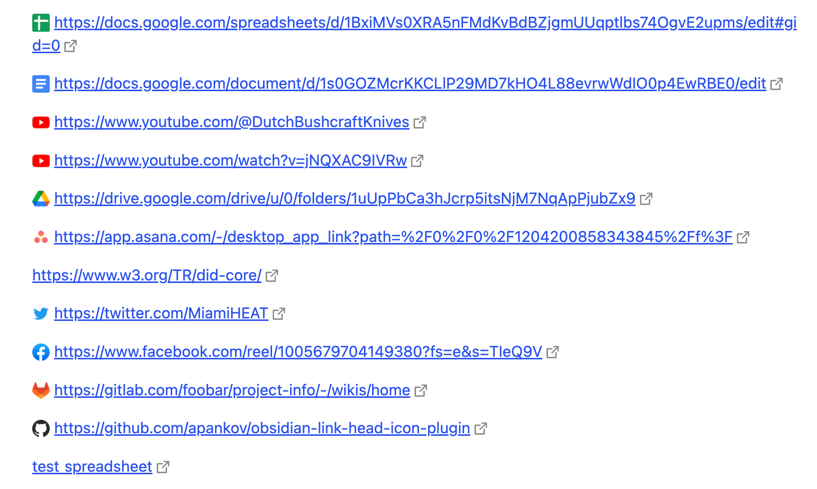

# Obsidian 'Link Head Icon' Plugin

This Plugin shows little image in reading mode ahead of external links to some common websites. Such a behaviour is highly inspired by how Asana became to refer to external documents.

**Example**



Supported sites: Google Docs, Google Sheets, Google Drive, YouTube, Twitter/X, GitHub, GitLab, Facebook, Asana, npm.

## How to install

1. Go to **Community Plugins** in your [Obsidian](https://www.obsidian.md) Settings and **disable** Safe Mode
2. Click on **Browse** and search for „Link Head Icon“
3. Click install
4. Toggle the Plugin on in the **Community Plugins** Tab

## Development

Requires Node.js 22.12 or newer.

```sh
npm install
npm run dev    # rebuild main.js on change
npm run build  # type-check and production build
npm run lint
npm test
```

To try it in a vault, copy `main.js`, `manifest.json` and `styles.css` into `<vault>/.obsidian/plugins/link-head-icon/` and reload Obsidian.

To add a site, put a PNG in `assets/`, import it in `src/icons.ts` and add a rule to `src/websites.ts`.

### Releasing

```sh
npm version patch   # bumps package.json, manifest.json and versions.json, then tags
git push --follow-tags
```

The tag triggers a workflow that builds the plugin and creates a draft GitHub release. Publish the draft to make it available to Obsidian.

# TODO

1. Verify the plugin on the mobile app.
2. Show image icons in editing mode.
